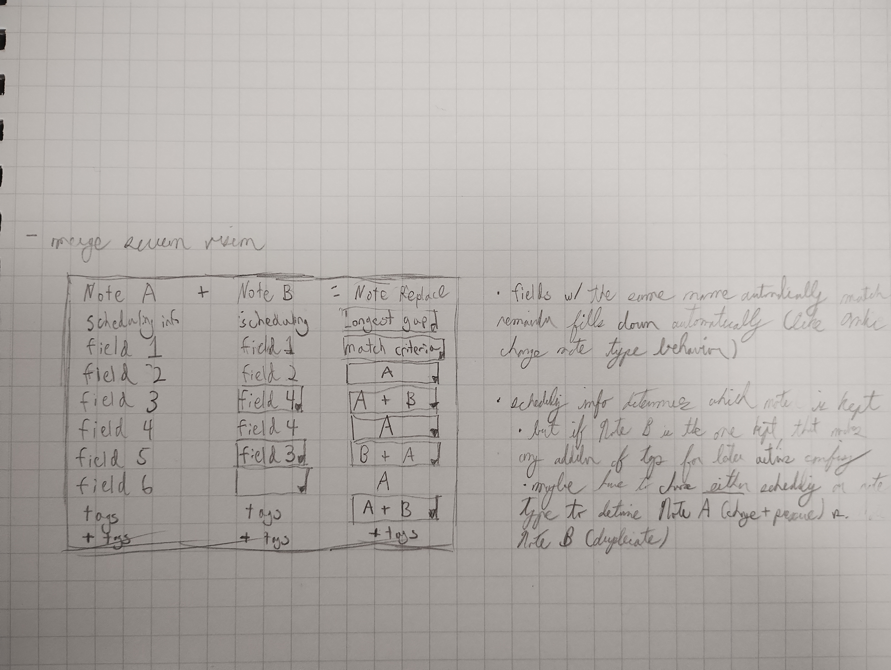

# Anki Merge Notes Design Draft Scratchsheet

## Use Cases

1. All resource deck info -> Main deck notes
2. Mining--sentence tacked on to previous note
3. Merging legacy duplicate notes

## Necessary Steps

### Identify duplicates; pair up notes

- what counts as a match?
  - basic: if a specific field in both notes match
  - important evolution: if multiple fields match (AND/OR)
  - addition: allowing regex
  - even more sophisticated: allowing custom comparison scripts
- how do you search for duplicate notes?
  - two models:
    - pool A and pool B. searching through pool B for matches with pool A.
    - a single pool A. Searching through pool A for matches with pool A
  - most efficient algorithm for each presumably differs
    - (2 pools: # words in pool A * # words in pool B?)
    - (1 pool: ~ # words in pool A! , but less than ! because you're also removing the duplicate from the remaining pool?)

### Merge information within pair

#### Merge screen vision

Original notebook sketch: 

Legend: `[… ▾]` = dropdown the user can change; plain text = filled in automatically.

| Note A          | + Note B        | = Note Replace       |
|-----------------|-----------------|----------------------|
| scheduling info | scheduling info | `[longest gap ▾]`    |
| field 1         | field 1         | `[match criteria ▾]` |
| field 2         | field 2         | `[A ▾]`              |
| field 3         | `[field 4 ▾]`   | `[A + B ▾]`          |
| field 4         | field 4         | `[A ▾]`              |
| field 5         | `[field 3 ▾]`   | `[B + A ▾]`          |
| field 6         | `[(none) ▾]`    | A                    |
| tags            | tags            | `[A + B ▾]`          |
| + tags          | + tags          | + tags               |

##### How to read it (for Claude, by Claude):

- One row per Note A field. The Note B column says which B field feeds that
  row; the Note Replace column says how the two are combined.
- Note B dropdowns appear only where the automatic match was overridden
  (field 3 ← B's field 4, field 5 ← B's field 3) or nothing matched (field 6).
- One B field can feed several result rows (B's field 4 feeds both field 3
  and field 4 above). Unlike Anki's Change Note Type, the mapping is not
  one-to-one.
- Note Replace options seen so far: `A`, `A + B`, `B + A` (order of
  concatenation), `longest gap` (scheduling), `match criteria`.
- Where B has nothing to offer (field 6), the result is fixed to `A`, so no
  dropdown.
- Bottom row: extra tags to add to each note, for later actions.

#### Notes

- fields with the same name automatically match; the remainder fill down automatically (like Anki's Change Note Type behavior)
- scheduling info determines which note is kept
  - but if Note B is the one kept, that makes any addition of tags for later action confusing
  - maybe have to choose *either* scheduling or note type to determine Note A (change + preserve) vs. Note B (duplicate)
  - can you actually transfer scheduling info across cards? I think that might require building an entirely different addon.

### Take action on resulting notes

- merged note
  - unsuspend/change deck
- spare duplicate note
  - tag/delete
