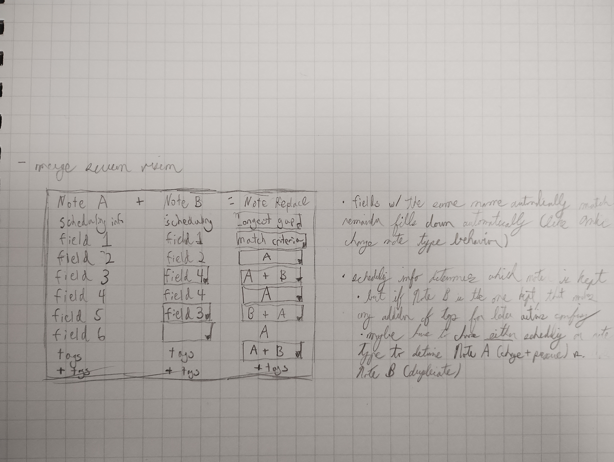

# Anki Merge Notes Design Draft Scratchsheet

My original version of this scratchsheet is saved as `design-draft-original.md`.

## Goal

Merge notes in batches: find matching notes between pools by rule, combine each
pair into an existing note using per-field rules, then deal with the spare note.
It should work for other people and other Anki versions, not only my setup.

## Decisions

- **Build a new tool, starting as a script.** No maintained add-on I've found
  merges between pools by rule, or lets you choose a rule for each field while
  keeping an existing note (see Prior Art). The merge screen comes later and
  reuses the same core.
- **Note A + Note B = modified Note A** (see Data Model).
- **Licence: AGPL-3.0-or-later**, like Anki and AJT Merge Notes, so source files
  say "version 3 or later".
- **Matching starts with one field and AND.** OR comes later; it isn't needed
  now, but it's the kind of option people expect to find (see Identify
  duplicates).
- **Normalising is opt-in.** Users choose the normalising steps for each key
  part to suit their own data, and nothing is applied unless chosen (see Identify
  duplicates).
- **Piles of three or more merge one pair per run**, and several pool-A notes in
  one pile are reported, not merged (see Identify duplicates).
- **Note Replace options: `A`, `B`, `A + B`, `B + A`, and each means exactly what
  it says.** `A + B` appends even when A and B overlap, and `B` replaces even when
  B is empty; the dry-run report flags any field that would be emptied. The `match
  criteria` row keeps A (the recipe stores it as `A`), because keys that match
  after normalising can still differ in their raw text.
- **Separator: set per row and editable by the user, default `<br>`.**
- **Role rules are for one-pool runs only.** In a two-pool run the pool-A note
  is always Note A. In a one-pool run, the scheduling role rule is "studied
  longest" (see Data Model).
- **A spare tag, no "processed" tag** (see Necessary Steps).
- **Tags and actions go only to merged notes.** Every pair that apply processes
  counts as merged, even when Note A's text doesn't change: Note A gets the
  recipe's tags, and Note B gets the spare tag and its own tags and is suspended.
  Notes that are only reported (no match, ambiguous, waiting, no recipe) are never
  touched. The sketch's Note A and Note Replace `+ tags` cells are one setting.
- **New cards are intended.** If filling a field makes Anki create cards (such as
  `kanji1` in `master_vocab`), those cards should exist, so the tool doesn't
  predict or flag them.
- **Oldest supported Anki version: 25.07**, for both the script and the add-on,
  so all code is written for Python 3.13. Anki 23.10–25.02 bundle Python 3.9,
  which is past end-of-life, and 25.07 (the new launcher) jumps straight to 3.13;
  no release shipped 3.10–3.12. Supporting older versions would mean writing for
  Python 3.9.
- **First batch job: use case 1** (resource deck into Main) on the `test` profile.
- **Only the final real run touches my real collection.** Pairing surveys,
  timing runs and rehearsals all use the copy of it in the `test` profile.
- **Not now:** card swaps (see Scheduling), and saving piles between runs. Piles
  are rebuilt each run; time a rebuild on the copy in `test` first, and if it's
  slow, save each note's keys with its last-modified time and a key spec version.

## Use Cases

1. All resource deck info -> Main deck notes
2. Mining--sentence tacked on to previous note
3. Merging legacy duplicate notes

Each one is the same pipeline with different settings. The searches here are
only examples:

| Use case | Pool A      | Pool B               | What makes a note Note A                          |
|----------|-------------|----------------------|---------------------------------------------------|
| 1        | `deck:Main` | `deck:Resource`      | Being in pool A                                   |
| 2        | `deck:Main` | `deck:Mining`        | Being in pool A                                   |
| 3        | `deck:Main` | (none: one-pool run) | A role rule, such as note type or studied longest |

In use case 2, mined notes wait in `deck:Mining`. After a run,
`deck:Mining -tag:<spare tag>` lists the mined notes that matched nothing. Moving
them into Main is a Browse action, and once moved they're in pool A for later
runs.

## Data Model

### Note A + Note B = modified Note A

- **Note A** is the note that survives. Its note ID, GUID, creation date, note
  type and cards all stay, and its note type defines the result's fields.
- **Note B** is only read from during the merge. It is then tagged and suspended,
  and can be deleted later.
- **A and B are roles, not origins.** Pools say where notes come from. In a
  two-pool run the pool decides: the pool-A note is always Note A. In a one-pool
  run, a *role rule* says which note of a pair is Note A: a tag, its note type, or
  an ordering such as studied longest, due date or sort field. AJT Merge Notes'
  direction options are examples of that last kind.
- **Role rules form an ordered list of tie-breakers**, like sorting by several
  columns: for example, note type, then studied longest, then older note ID. When
  two notes tie on one rule, the next rule decides. A list that ends in a rule
  that always decides (such as note ID) never leaves a pair undecided; otherwise
  undecided pairs are reported, not merged.
- **Role rules belong to a run's settings, not to a recipe.** A recipe is looked
  up by Note A's note type, so Note A has to be chosen before a recipe can be.
- **Studied longest** keeps the note you've had longest, not the one with the
  best stats, since a card's stats partly come from reviews of its duplicate. The
  tool works it out from the cards and the review log itself:
  - A note is *studied* if any of its cards has a review log row with a rating
    (`button_chosen` > 0). Set due date, Forget and Reschedule rows have no
    rating, so they don't count. A studied note beats a new one.
  - Between studied notes, the earliest rated review across the note's cards
    wins.
  - Between new notes, the one closest to being studied wins: the lowest
    new-card position (the number Browse shows as Due). That's the card's `due`,
    or its `odue` while the card is in a filtered deck. A deck's display order
    can show cards in a different order, but the stored position is what's
    compared.
  - Suspended and buried cards count like any others. The merged note can be
    unsuspended afterwards (see Take action).
  - It doesn't use `col.card_stats_data(card_id).first_review`. Up to 25.09 that
    counts unrated rows such as Set due date as reviews, and from 26.05 it
    doesn't, so the result would depend on the Anki version. The same call gives
    no position for suspended or buried new cards.
  - It reads only ratings, review dates and positions, so it doesn't depend on
    FSRS fields, which change between Anki versions. The data comes from
    `col.get_card` and `col.card_stats_data(card_id).revlog`, or from one
    read-only SQL query (which `SAFETY.md` allows), and only for the notes that
    need it: those in one-pool piles, and each pair's Note B (see Scheduling).

Why not a new Note C:

- Its cards would all start as new, unless cards or history were brought over
  from both old notes.
- It would have a new note ID, GUID and creation date, so anything that refers
  to the old notes, such as shared-deck updates, would stop matching.
- Its main gain is being able to use a third note type.

### Data passed between stages

| Name           | Holds                                                                                  |
|----------------|----------------------------------------------------------------------------------------|
| Note snapshot  | Note ID, note type, field values by name, tags, last-modified time                     |
| Study summary  | Only for notes in one-pool piles and each pair's Note B: whether it's studied, its first rated review, its lowest new-card position |
| Key spec       | Named key parts (such as `word` and `reading`); for each note type, the field each part comes from and the normalising steps chosen for it |
| Pair           | Note A's ID, Note B's ID, the key they matched on, the rule that decided which is Note A |
| Pairing result | Pairs, notes with no match, notes with no key, notes with several keys, notes in both pools, ambiguous matches, pairs with role undecided, pairs with no recipe |
| Field rule     | Which Note B field feeds this row (or none), how to combine them, the separator        |
| Recipe         | For one Note A type and Note B type: a field rule for each Note A field that changes (the rest stay `A`), tags to add to Note A, tags to add to Note B |
| Merge plan     | For one pair: Note A's new field values and tags, whether Note A changes, fields that would be emptied, Note B's non-empty fields that no row uses, whether Note B has been studied, Note B's tags and suspension |
| Report         | Saved for each run: what happened to each pair, and Note A's old field values and tags |

## Necessary Steps

Each step can run on its own. Every real run follows `SAFETY.md`: a backup, a
dry run against the `test` profile, and writes only where content changed.
Everything before the final real run, including read-only surveys, uses the copy
in `test`.

Reruns are safe without a "processed" tag:

- When merged, Note B gets a *spare tag*. The tool adds `-tag:<spare tag>` to
  each pool search itself, so an old spare never takes a new note's place in a
  pile. It builds the search with `col.build_search_string`, which brackets the
  user's search correctly (such as `deck:A or deck:B`) and quotes the tag name.
  There is one spare tag for the whole run, not one per recipe, because every
  pool search has to exclude it.
- Note A is never excluded. If the same word is mined again later, the new note
  still finds it.
- Note A's new fields and tags and Note B's spare tag are written in one
  `col.update_notes` call for the whole batch, which Anki runs as one database
  transaction. A run that stops partway has written all of it or none of it, so
  a rerun can never append B's text a second time.
- Note B is suspended after that write. Each report counts spares that still have
  unsuspended cards (`tag:<spare tag> -is:suspended`), so a run that stopped in
  between shows up.

### Identify duplicates; pair up notes

- what counts as a match?
  - basic: if a specific field in both notes match
  - important evolution: if multiple fields match (AND/OR)
  - addition: allowing regex
  - even more sophisticated: allowing custom comparison scripts
- how do you search for duplicate notes?
  - two models:
    - pool A and pool B. searching through pool B for matches with pool A.
    - a single pool A. Searching through pool A for matches with pool A
  - pools are Anki search strings, such as `deck:Main` or `tag:mined`. People
    already know that language, and terms like `-tag:` and `edited:` make runs
    incremental without extra code.
- how matching works: turn each note into a *key*, then group notes by key in a
  dictionary. Both pool models then become the same algorithm.

  Think of sorting paper flashcards by headword. You don't hold each card up
  against every other card; you look at each card once and put it on the pile
  labelled with its word. The *key* is the label worked out from one note, and the
  *dictionary* (Python's `dict`) is the set of labelled piles: key → notes.

  | Note | Pool | Raw field                     | Key after normalising |
  |------|------|-------------------------------|-----------------------|
  | 101  | A    | Expression: ` 上手[じょうず]` | `上手`                |
  | 102  | A    | Expression: ` 下手[へた]`     | `下手`                |
  | 201  | B    | Word: `上手`                  | `上手`                |
  | 202  | B    | Word: `<b>猫</b>`             | `猫`                  |

  This example strips HTML and furigana to stay short. Both are normalising steps
  the user chooses, and stripping furigana on its own would let homographs pair
  (see below).

  One pass over the notes gives:

  ```
  {"上手": {A: [101], B: [201]},
   "下手": {A: [102], B: []},
   "猫":   {A: [],    B: [202]}}
  ```

  Reading each pile with two pools, where A and B count pool-A and pool-B notes
  (in a two-pool run, the pool-A note is always Note A):

  | Pile                 | Result                                                          |
  |----------------------|-----------------------------------------------------------------|
  | 1 A and 1 B          | A pair                                                          |
  | One side empty       | Unmatched                                                       |
  | 1 A and several B    | A pairs with one B (oldest note ID); the rest wait for the next run |
  | Several A            | Ambiguous: reported, not merged, because choosing the A would be a guess |

  With one pool there are no sides. A pile of 1 has no duplicate. In a pile of 2
  or more, the role rules pick Note A from all of them, and it pairs with the note
  with the oldest note ID among the rest; the others wait for the next run.
  One-pool runs are a mode of their own: there is no pool B, so the rule about
  notes found by both pool searches doesn't apply.

  Merging only one pair per note per run keeps the plans independent: no plan
  depends on another plan's result. The dry run flags piles with notes left
  waiting, which is where some homographs show up; others pair silently (see
  below).

  It is fast because a `dict` goes straight to a pile from its label (by
  hashing), instead of searching, so the cost is one step per note:

  | Method               | Two pools       | One pool of n notes     |
  |----------------------|-----------------|-------------------------|
  | Comparing every pair | A x B           | n(n-1)/2, not factorial |
  | Grouping by key      | about A + B     | about n                 |

  For 30,000 notes in one pool, that's about 450 million comparisons against
  30,000 dictionary entries.
- a key function takes one note snapshot and returns a *set* of keys:
  - an empty set means the note can't be matched, for example because its key
    field is empty. Those notes are reported, never grouped under `""`, which
    would put every empty note on one huge pile.
  - until the grouping step that OR needs is built (see below), a note with more
    than one key is reported and left out, like a note with no key, so no note
    can end up in two pairs.
  - a key is made of named *parts*, set per note type in a *key spec*, because the
    two pools usually use different note types and field names (`Expression` in
    Main, perhaps `Word` and `Reading` in a resource deck). Each part is one field
    plus the normalising steps chosen for it. Every note type in a run gives the
    same parts, and a key with an empty part counts as no key.
- every match type above fits a key: AND is a combined key such as
  `("上手", "じょうず")`, regex uses what the pattern captures, and a custom
  script returns keys for one note instead of comparing two notes. Only fuzzy
  matching, such as "this field contains that one", needs to compare pairs.
- OR is the awkward one: it gives one key per field, so a note lands on several
  piles. Note 101 could match 201 by Expression and 305 by Reading. Piles that
  share a note have to be joined into one group, and a joined group with more
  than one note on a side is ambiguous. Decided: one field and AND first, OR
  later.
- normalising is opt-in: a menu of small steps chosen for each key part, because
  raw field text has furigana (` 漢字[かんじ]`), HTML and `&nbsp;`, and each
  user's data needs different ones. Steps to offer: strip HTML, decode entities
  such as `&nbsp;`, trim spaces, remove punctuation, keep only the kanji (like
  Anki's `kanji:` filter), keep only the reading (like `kana:`), and fold
  full-width and half-width forms. Nothing is applied unless chosen, and the
  pairing survey shows what still doesn't match.
- matching on the word alone pairs homographs silently when each pool has only
  one of them: Main's ` 上手[じょうず]` and a resource note's `上手` read かみて make
  a pile of 1 + 1, and nothing flags it. Comparing the reading too avoids that.
  If both note types write furigana the same way, the raw `Expression` field
  already does. If the other type keeps word and reading in separate fields, use
  two parts, `word` and `reading`, both taken from Main's `Expression` with the
  kanji-only and reading-only steps.
- the output is a result to review, not only a list of pairs:
  - notes with no match, notes with no key, and notes with several keys
  - notes found by both pool searches, reported and left out of pairing, so a
    note is never on both sides
  - pairs where the role rule couldn't decide which note is Note A
  - ambiguous matches (several pool-A notes in one pile), reported and never
    merged automatically. For example, 上手 read じょうず and 上手 read かみて
    would collide if matching on the word alone.
  - notes left waiting for the next run
  - pairs whose note types have no recipe, skipped and reported

### Merge information within pair

#### Recipes

The merge screen below describes a *recipe*: rules for one combination of Note A
type and Note B type, filled in once and applied to every pair of those types.
That is what makes batch processing possible. The script keeps recipes in a JSON
config file, which the merge screen can later write with Python's standard
library; JSON is also Anki's own add-on config format. The merge screen later
edits them and adds a per-pair preview.

A recipe lists only the rows that change, and unlisted rows stay `A`. Config
names note types and fields by name, and the collection layer checks every name
before anything runs. A pair whose note types have no recipe is reported and
skipped, never merged with an implied all-`A` recipe.

#### Merge screen vision

Original notebook sketch: 

Legend: `[… ▾]` = dropdown the user can change; plain text = filled in automatically.

| Note A          | + Note B        | = Note Replace       |
|-----------------|-----------------|----------------------|
| scheduling info | scheduling info | `[studied longest ▾]` |
| field 1         | field 1         | `[match criteria ▾]` |
| field 2         | field 2         | `[A ▾]`              |
| field 3         | `[field 4 ▾]`   | `[A + B ▾]`          |
| field 4         | field 4         | `[A ▾]`              |
| field 5         | `[field 3 ▾]`   | `[B + A ▾]`          |
| field 6         | `[(none) ▾]`    | A                    |
| tags            | tags            | `[A + B ▾]`          |
| + tags          | + tags          | + tags               |

The sketch says `longest gap`. It was renamed `studied longest` by decision on
2026-11-08 (see Data Model).

##### How to read it (for Claude, by Claude):

- One row per Note A field. The Note B column says which B field feeds that
  row; the Note Replace column says how the two are combined.
- Note B dropdowns appear only where the automatic match was overridden
  (field 3 ← B's field 4, field 5 ← B's field 3) or nothing matched (field 6).
- One B field can feed several result rows (B's field 4 feeds both field 3
  and field 4 above). Unlike Anki's Change Note Type, the mapping is not
  one-to-one.
- Note Replace options: `A`, `B` (implied in the sketch), `A + B`, `B + A`
  (order of concatenation), `studied longest` (scheduling), `match criteria`.
  The recipe stores `match criteria` as `A`.
- The scheduling row isn't part of the recipe. A recipe is looked up by Note A's
  type, so Note A is chosen first: by pool in a two-pool run (the row then shows
  pool A), or by the role rules in a one-pool run (the row shows their choice,
  such as studied longest). Changing it in a per-pair preview would swap A and B
  and switch to the other recipe.
- Where B has nothing to offer (field 6), the result is fixed to `A`, so no
  dropdown.
- Bottom row: extra tags for later actions. The Note A and Note Replace cells
  are one setting, because the result is Note A. The Note B cell adds tags to the
  spare, alongside the spare tag. Tags only go to notes that were merged.

#### Notes

- fields with the same name automatically match; the remainder fill down automatically (like Anki's Change Note Type behavior)
- rows default to `A`, so nothing changes until a rule is chosen. With 48-field
  notes, the screen should hide rows where nothing happens.
- combining with `A + B` or `B + A`:
  - each row sets its own separator, which the user can edit; the default is
    `<br>`
  - if either side is empty, no separator is added. "Empty" uses Anki's own
    definition: only whitespace and `<br>` or `<div>` tags, so `&nbsp;` is not
    empty
  - the two are always joined, even when B's text is already in A. Optionally,
    the report flags rows where it is, so doubled text is easy to spot in the dry
    run
- `B` always replaces A's field, even when B's field is empty. The dry-run report
  flags every field that would be emptied
- a plan is compared with the note in the form Anki saves: fields in Unicode NFC,
  and tags compared without case, since Anki matches a tag's case to existing
  tags. Otherwise reruns would see changes that aren't real and rewrite notes
- merging tags skips `leech`, as AJT Merge Notes does
- writing to an empty field can create a new card if a template depends on that
  field (tested). The `kanji1` and `kanji2` fields in `master_vocab` work this
  way. Those cards are intended: if a merge fills the field, the card should
  exist, so the tool doesn't predict or flag them.

#### Plan, then apply

- **Plan** works out the result for one pair and writes nothing. A dry run is
  just printing the plans.
- **Apply** writes the plans. Every planned pair counts as merged, even when
  Note A's text doesn't change. Note A is written only if its fields or tags
  differ, and a pair is skipped only if a note has changed since it was planned.
- **One run goes from plan to apply.** The script plans, saves the report, shows
  a summary and asks before applying those same plans. `--dry-run` stops after
  the report. Reports are sorted by note ID, so two runs' reports can be compared
  with `diff`.
- **The report** is a short summary in the terminal plus a TSV file (one row per
  pair, values before and after) that opens in LibreOffice. It keeps Note A's
  old fields and tags, so one bad merge can be put back by hand. The script has
  no Undo, and restoring a backup would also lose any reviews done since.

### Take action on resulting notes

- merged note
  - unsuspend/change deck
- spare duplicate note
  - tag/delete
  - suspend straight after the merge, so it stops coming up in reviews
  - before deleting, check the report's list of Note B fields that no row used
  - deleting a spare that came from a shared deck means re-importing that deck
    adds it back as a new note, because its GUID is gone. Keeping it suspended
    avoids that.

Apart from suspending, these can start as ordinary Browse actions on the tags the
merge adds, with no code needed. Tags and actions only ever touch notes that were
merged; notes that were only reported are left alone. Moving use case 2's
unmatched mined notes into Main works the same way (see Use Cases).

## Scheduling

Scheduling belongs to cards, not notes, so a note with four templates has four
separate schedules. The `scheduling info` row is really one decision per template.

**First version: nothing moves.** Note A keeps its cards and Note B keeps its own.
In use cases 1 and 2, Note B is presumably unstudied, so nothing is lost; the plan
flags any pair where Note B has rated reviews, so that's checked rather than
assumed. This also settles the earlier question of whether scheduling or note
type decides Note A: in a two-pool run the pool decides, and in a one-pool run the
role rules decide. When both notes share a note type, that can be studied
longest.

**Can scheduling be transferred?** Checked against Anki 26.09.2 on 2026-11-01:

- **Copying the schedule** works through the normal API, but the list of fields
  grows with Anki versions (FSRS fields by 23.10, `decay` and `last_review_time`
  by 25.09), and missing one gives wrong results. In one test, a missing
  `last_review_time` changed the next FSRS stability from about 77 to about 8.
- **Copying review history** has no API: Anki's library can read the review log
  but has no function for adding rows directly. Add-ons that do it use raw SQL,
  which `SAFETY.md` forbids.
- **Moving the card** avoids both problems: change its `nid` and `ord` with
  `col.update_card`, and the history stays attached because log rows point to the
  card ID.

**Later option: swap cards when Note B's card is clearly better.** Notes A and B
trade cards in that template slot, so neither note has a gap. Nothing is deleted,
and Note B stays in Browse with its text and tags until it is deleted as usual.

- Tested (built-in note types, SM-2 and FSRS): a moved card kept its schedule and
  log rows, showed the new note's text, passed Check Database and undid in one
  step. One sync test between two local collections finished as a normal sync,
  while Change Note Type demanded a one-way sync.
- Traps: an invalid `ord` is accepted without error, and Check Database then
  deletes the card (tested). A note with an empty template slot regrows a New card
  when saved or checked, and Browse's Notes mode treats a note with no cards as an
  error (both read in the source, not run).
- Deleting a note leaves its review log rows in the database, attached to no card
  (tested).
- Not tested: swapping itself, AnkiWeb, AnkiDroid, `master_vocab`, and other Anki
  versions (one attempt was inconclusive).

## Architecture

Three layers, so that most of the code never touches Anki:

| Layer            | Does                                                | Imports Anki?             |
|------------------|-----------------------------------------------------|---------------------------|
| Core             | Normalise, make keys, pair, plan                    | No                        |
| Collection layer | Read notes and study data, check names, write plans | Yes                       |
| Front ends       | Script now, merge screen later                      | Only the screen's Qt code |

- Tests come in three layers:
  - **Unit tests** for each core function on plain data: normalising steps,
    keys, pairing, row rules and plans. They're fast and make up most of the
    tests.
  - **Whole-pipeline tests** on a small library of test notes, defined in code
    and loaded into a throwaway collection with the `anki` library. Each note
    covers one case: a homograph pair, a suspended new card, a card in a filtered
    deck, a Set due date row, an empty B field, a `kanji1`-style conditional
    template. The same tests can later run against other Anki versions.
  - **The rehearsal** on the copy of the collection in the `test` profile, before
    each real run.
- Differences between Anki versions stay in one small layer.
- All code targets Python 3.13, which Anki 25.07 and newer bundle. The core uses
  only Python's standard library, because add-ons can't install packages.
- Field and note type names live in recipes and config, not in the code. The
  collection layer checks every name before anything runs.

## Build Order

1. **Setup:** Python 3.13.15 `.venv`, `anki` pinned to the desktop version, a test
   runner, a linter set to Python 3.13 (`target-version = "py313"`), `.gitignore`.
2. **Pairing survey:** normalising steps, keys and pairing in the core, reading
   notes in the collection layer, and a read-only pairing report, with tests. Run
   it on the copy in `test` only. It shows the real numbers of pairs, ambiguous
   piles and notes with no key, and how long a rebuild takes, before any merge
   code exists.
3. **Merging:** recipes, plans and apply, with tests; a dry run and rehearsal on
   `test`; then the first real batch job (use case 1), using the `anki` library
   with Anki closed. Role rules and studied longest come with use case 3, since
   two-pool runs don't need them.
4. **Add-on:**
   - **4a. Menu action:** run a recipe file inside Anki through `CollectionOp`,
     with the whole batch as one undo step, so merges can be undone with Anki's
     Undo button (a script can't, because Anki keeps undo history only in memory
     while it's running). Before building it, check that `add_custom_undo_entry`
     and `merge_undo_entries` work on 25.07 and newer: an earlier test ended in
     `UndoEmpty` on 24.11+, probably because Check Database ran first.
   - **4b. Merge screen:** edit recipes and preview plans.
5. **Later:** card swaps, testing on other Anki versions, publishing.

## Prior Art

Read on 2026-11-01 from each add-on's code and README. None of them were run, and
AnkiWeb's pages wouldn't load, so ratings and supported versions weren't checked.
Other add-ons may exist.

### How this project compares with maintained add-ons

These are the add-ons read that have been updated in about the past year. This
project is still only a plan, and they already exist.

|  | This project (planned) | [AJT Merge Notes](https://github.com/Ajatt-Tools/mergenotes) | [Merge Notes](https://github.com/athulkrishna2015/anki-merge-notes-addon) | [Transfer Scheduling Data + FSRS](https://github.com/Jonathan-Greve/AnkiTransferScheduling) |
|---|---|---|---|---|
| Last commit | None yet | 2026-11 | 2026-06 | 2025-11 |
| Licence | AGPL-3.0-or-later | AGPL-3.0 or later | None stated | GPL-3.0 |
| Result | Existing note | Existing note | New note | No merging, scheduling only |
| Per-field rules | `A`, `B`, `A + B` or `B + A` on each row | Chosen fields append, all in one direction | Any source fields append into each field | None |
| Field mapping | Any B field, across note types | Same-named fields only | Any source field, across note types | None |
| Finding notes | By rule, one or two pools | Browser selection, or Find Duplicates in one pool | Browser selection | Two cards picked by hand |
| Batch | Yes, one recipe per note type combination | Yes, for Find Duplicates groups | No | No |
| Dry run or preview | Yes | No | No | No |
| Scheduling and history | Note A keeps its cards; swaps possible later | Not moved | One card's copied onto the first new card | One card's moved to another |
| How it writes | Anki's API only | Anki's API, one undo step | Anki's API, raw SQL for history | Raw SQL |

**What this plan adds:** merging between pools by rule, choosing a direction for
each field, mapping any B field into an existing note, one recipe across a batch,
and a dry run before anything is written. None of the add-ons above combines these.

**What they have that this plan doesn't:** they exist today and have interfaces.
AJT Merge Notes and Merge Notes also merge three or more notes at once, where this
plan merges one pair per run. For duplicates of the same note type, AJT Merge
Notes may already be enough, so it's worth trying before building that path.

**Ideas worth taking:**

- AJT Merge Notes: options to ignore HTML, furigana, punctuation and
  full-width/half-width differences when comparing (taken, as opt-in normalising
  steps), and dropping duplicate text when appending (not taken: `A + B` always
  appends, and the report can flag doubled text instead).
- Merge Notes: a warning before deleting a note whose content wasn't mapped, and
  remembering mappings per note type.

### Older add-ons worth reading

These were last updated in 2024 or earlier.

| Add-on (last commit) | Licence | What it offers this project |
|---|---|---|
| [anki-merge-notes](https://github.com/klieret/anki-merge-notes) (2019) | AGPL-3.0 | Closest concept: two tagged pools, per-field modes, ambiguity report. Python 2, configured by editing its source |
| [Note Comparer](https://github.com/ramonamerong/Note-Comparer-Anki) (2021) | MIT | Groups with AND/OR conditions and regex |
| [Merge Duplicates](https://github.com/Garbaz/anki-merge-duplicates) (2024) | MIT | A very small example: one merge mode for all fields, keeping the note with the most reviews |
| [anki-cp](https://github.com/seangenabe/anki-cp) (2019) | MIT | Copies scheduling between decks by sort field, using raw SQL |
| [AnkiMergeScheduling](https://github.com/pcdi/AnkiMergeScheduling) (2019) | MIT | Copies scheduling between duplicates and tags both notes for checking |

### Reusing code

This project's goals and this design decide the interface and architecture. The
add-ons above are references, not templates. Where their code is genuinely
useful, adapting it is better than rewriting it, because adapting credits the
authors. Code from AJT Merge Notes, anki-merge-notes and the MIT add-ons can be
adapted under this project's AGPL-3.0-or-later licence, keeping their copyright
and licence notices and noting in each file where the code came from. Code is
never copied with only names changed and no credit. Merge Notes states no
licence, so it's for reading only.

## Open Questions

None at the moment. The answers are under Decisions.
